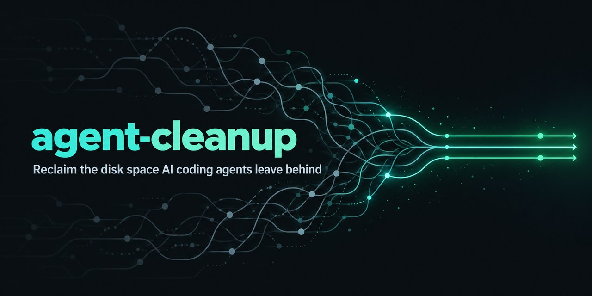
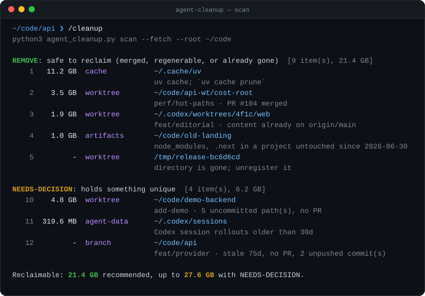
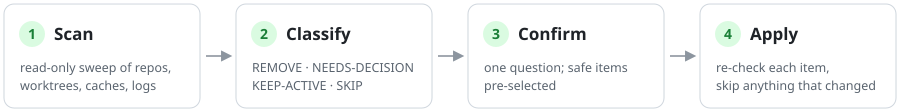

<p align="center">
  
</p>

<h1 align="center">agent-cleanup</h1>

<p align="center">
  <b>Clean up stale git worktrees, merged branches, <code>node_modules</code>, package caches and agent session logs.</b><br>
  Works as a <code>/cleanup</code> skill in Claude Code, Codex, Cursor, Gemini CLI, OpenCode and GitHub Copilot, or as a standalone Python CLI.
</p>

<p align="center">
  <a href="https://github.com/luchasarie/agent-cleanup/actions/workflows/test.yml"></a>
  <a href="LICENSE"></a>
  
  
  <a href="https://agentskills.io"></a>
</p>

<p align="center">
  <a href="#install">Install</a> ·
  <a href="#use">Use</a> ·
  <a href="#what-it-finds">What it finds</a> ·
  <a href="#safety">Safety</a> ·
  <a href="#faq">FAQ</a>
</p>

---

Agents like Claude Code, Codex, Cursor and Conductor run each task in its own git worktree. Each worktree is a full checkout, and many get their own `node_modules` or `.venv`. Tasks get merged and the worktrees stay. Add branches nobody deletes, `backup-before-refactor.tar.gz` files, package caches and months of session logs, and a laptop can lose tens of gigabytes without anyone noticing.

`agent-cleanup` finds all of it and sorts what is safe to delete from what still holds unique work. Nothing is deleted until you pick it. It works with any agent that supports [Agent Skills](https://agentskills.io), and you can also run it by hand.

<p align="center">
  
</p>

<p align="center">
  <picture>
    <source media="(prefers-color-scheme: dark)" srcset="assets/flow-dark.svg">
    
  </picture>
</p>

## Install

With the [`skills`](https://github.com/vercel-labs/skills) installer, which sets it up for whichever agents you use:

```sh
npx skills add luchasarie/agent-cleanup
```

Or copy `skills/cleanup` into your agent's skills folder:

| Agent | User-level folder |
|---|---|
| Claude Code | `~/.claude/skills/cleanup` |
| Codex, Cursor, Gemini CLI, OpenCode | `~/.agents/skills/cleanup` |
| GitHub Copilot | `~/.copilot/skills/cleanup` |

```sh
git clone https://github.com/luchasarie/agent-cleanup
cp -r agent-cleanup/skills/cleanup ~/.claude/skills/     # or ~/.agents/skills/
```

Requirements: Python 3.9+ and git, on macOS, Linux or WSL. The [GitHub CLI](https://cli.github.com) (`gh`) is optional. With it, branches that were squash-merged on GitHub show up as merged by their PR state. Without it, a content check still catches most of them.

## Use

In your agent, type `/cleanup`, or ask something like *"my disk is full, clean up"* or *"delete merged worktrees"*. The agent:

1. Scans. By default it covers the current repo, the agent worktree folders, package caches, agent logs and the trash. For a whole-machine sweep it adds the folders where your projects live.
2. Asks once. REMOVE items are pre-selected. Each NEEDS-DECISION item is listed on its own with what is unique in it. KEEP-ACTIVE and SKIP items are never offered.
3. Applies what you picked. Each item is re-checked first, so anything that changed since the scan is skipped.
4. Reports the space freed and what it left behind, with the reason. For logs that keep growing, it points you at the agent's own retention setting.

### Without an agent

The script is a standalone CLI:

```sh
S=~/.claude/skills/cleanup/scripts/agent_cleanup.py

python3 $S scan                          # this repo + agent folders + caches + logs
python3 $S scan --root ~/code --fetch    # every repo and project under ~/code
python3 $S scan --only git --remote      # just worktrees and branches, including merged ones on origin
python3 $S apply --recommended --dry-run # preview
python3 $S apply 1-9 12                  # do it (plans older than 24h are refused)
python3 $S apply --remote 14             # remote branches need --remote here too
```

| Option | Default | |
|---|---|---|
| `--root DIR` | none | Folder of projects to sweep (repeatable) |
| `--only` | all | Any of `git,artifacts,archives,caches,agents,trash` |
| `--stale-days` | 14 | Untouched this long counts as stale |
| `--keep-days` | 30 | Agent logs newer than this are kept |
| `--recent-hours` | 24 | Merged worktrees with any file outside disposable folders like `node_modules` edited this recently are KEEP-ACTIVE, since an agent may still be working in them |
| `--min-size` | 20M | Hide storage items smaller than this |
| `--fetch` | off | `git fetch --prune` each repo first, so merge checks see the latest base branch |
| `--remote` | off | Also offer deleting merged branches on `origin` |
| `--base` | per repo | Base branch (default: `origin/HEAD`, then `main`/`master`) |
| `--agent-root DIR` | | Another folder where an agent keeps worktrees (also `AGENT_CLEANUP_WORKTREE_ROOTS`) |
| `--json` | | Print the plan as JSON |

## What it finds

| Kind | What | Class |
|---|---|---|
| `worktree` | Worktrees whose branch was merged (by PR, or because merging it changes nothing on the base branch, which catches squash and rebase merges) | REMOVE |
| `worktree` | Registered worktrees whose directory was deleted (`/tmp/...`, an old agent run). Only unregistered; the branch is classified on its own. | REMOVE |
| `worktree` | Worktrees with uncommitted files, ignored files that aren't build output (`.env`, local data), unmerged commits, or a closed PR | NEEDS-DECISION |
| `branch` | Local branches with no worktree, classified the same way | REMOVE / NEEDS-DECISION |
| `remote-branch` | `origin` branches whose local copy is merged and whose remote tip is merged too (only with `--remote`) | REMOVE |
| `orphan-worktree` | Folders whose `.git` file points at a repository that no longer exists | NEEDS-DECISION |
| `artifacts` | `node_modules`, `.next`, `.nuxt`, `.turbo`, `target`, `.gradle`, `.pytest_cache`, `playwright-report`, … in projects with no file touched for `--stale-days` and no process running inside. Inside a git repo, only directories git ignores and tracks nothing in. | REMOVE |
| `build-output` | `dist`, `build`, `out`, `coverage`, `.venv`, `venv` in the same projects. They may hold a release, an export or hand-installed packages. | NEEDS-DECISION |
| `archive` / `backup` | `.zip`, `.tar.gz`, `.dump`, `.sql`, `.bak` files and `*.bak-*`, `*-backup(s)`, `*.old` folders untouched for `--stale-days` and not tracked by git | NEEDS-DECISION |
| `cache` | npm, pnpm, yarn, bun, pip, uv, Go build, Homebrew, Xcode DerivedData, Docker build cache. Cleared with the tool's own command where it has one. | REMOVE |
| `agent-data` | Session logs older than `--keep-days` (see below). Claude Code's `memory/` files are never touched. | NEEDS-DECISION |
| `trash` | The desktop trash | NEEDS-DECISION |

Left alone: open PRs, anything touched in the last `--stale-days`, branches created recently but not yet committed to, the main checkout and base branch, long-lived branches (`develop`, `staging`, `release/*`, …), branches that track a live remote branch, locked worktrees, worktrees mid-rebase, worktrees a running process is inside (so an agent mid-task keeps its checkout), and worktrees on a drive that isn't mounted.

### Agent folders it knows

| Agent | Worktrees | Logs and state | Built-in retention |
|---|---|---|---|
| Claude Code | `<repo>/.claude/worktrees/` (via `git worktree list`) | `~/.claude/projects`, `file-history`, `debug`, `shell-snapshots`, `paste-cache` | `cleanupPeriodDays` (default 30) |
| Codex | `$CODEX_HOME/worktrees` | `$CODEX_HOME/sessions`, `archived_sessions`, `log` | none |
| Gemini CLI | | `~/.gemini/tmp` | `general.sessionRetention` (default 30d) |
| OpenCode | | `~/.local/share/opencode/snapshot`, `log` | none; `"snapshot": false` turns snapshots off |
| Cursor | `~/.cursor/worktrees`¹ | | `cursor.worktreeMaxCount` |
| Conductor | `~/conductor/workspaces`¹ | | |
| Vibe Kanban | `/var/tmp/vibe-kanban/worktrees` | | cleans orphans on startup |

¹ Not stated in the tool's docs; a missing folder is skipped. If your agent keeps worktrees somewhere else, pass `--agent-root` or [open an issue](https://github.com/luchasarie/agent-cleanup/issues).

Worktrees in any other folder are found through their repository. A scan with `--root` covers every repo under it, and every repo lists all of its worktrees, wherever they live.

## Safety

- **`scan` doesn't change your files.** It runs git with optional locks off, so it doesn't refresh the index. The merge check may leave a few loose objects that `git gc` removes later. `--fetch` updates remote-tracking refs.
- **Deletion takes a pick.** `apply --recommended` takes REMOVE items only. NEEDS-DECISION items need their id. KEEP-ACTIVE and SKIP items are refused even by id. Remote branches need `--remote` on both scan and apply.
- **Re-checked before acting.** `apply` re-runs the classification. A worktree with a new commit or file, an archive or backup with any change inside, a trash with new items: each is skipped. Plans older than 24 hours are refused.
- **git does the removal.** `git worktree remove` without `--force`, so git itself refuses a worktree that has changes. `--force` exists for when you've decided to throw those changes away.
- **Nothing unmerged is orphaned.** A branch with unmerged work is kept when its worktree goes. A detached worktree's commits, and a deleted branch's commits that no remote has, are saved under `refs/agent-cleanup/` first. A remote branch is deleted with a lease, so the push fails if anyone pushed to it after the scan.
- **Unknown means hands off.** If running processes can't be listed, every worktree counts as in use. If `git status` fails, the worktree needs a decision.
- **Logged.** Every action is appended to `~/.local/state/agent-cleanup/history.jsonl`.

Use `--dry-run` to see the exact commands first.

## FAQ

### How do I delete git worktrees after their branch is merged?

Run `/cleanup` in your agent, or run the script by hand with `python3 ~/.claude/skills/cleanup/scripts/agent_cleanup.py scan --only git` (adjust the path to wherever you installed the skill; see [Without an agent](#without-an-agent)). A worktree counts as merged when its PR was merged on GitHub or when merging its branch would change nothing on the base branch, so squash and rebase merges are caught too. `apply` then runs `git worktree remove` for the ids you pick and keeps any branch that still has unmerged work.

### How do I free up disk space used by Claude Code?

Claude Code keeps task worktrees in `<repo>/.claude/worktrees/` and logs in `~/.claude/projects`, `file-history`, `debug`, `shell-snapshots` and `paste-cache`. `agent-cleanup` offers merged worktrees for removal and logs older than `--keep-days` (30 by default) for a decision. Your `memory/` files are never touched. To stop logs piling up again, lower `cleanupPeriodDays` in Claude Code's settings.

### Where do Codex, Cursor and other agents keep their worktrees?

See [Agent folders it knows](#agent-folders-it-knows). Codex uses `$CODEX_HOME/worktrees` and keeps sessions under `$CODEX_HOME/sessions` with no built-in retention, so they grow until something deletes them. Cursor appears to use `~/.cursor/worktrees`, though its docs don't say so; the folder is skipped if it doesn't exist. Worktrees anywhere else are still found through their repository.

### Will it delete `node_modules` in a project I'm working on?

No. Build artifacts are only offered in projects where no file was touched for `--stale-days` (14 by default) and no process is running inside. In a git repo, only folders git ignores and tracks nothing in qualify. They come back with the next install or build.

### Is it safe to run?

`scan` doesn't change your files; with `--fetch` it updates remote-tracking refs. `apply` acts on the ids you pick, re-checks each one first, and skips anything that changed since the scan. Worktrees are removed by git without `--force`, unmerged commits are kept, and every action is logged. See [Safety](#safety).

### Can I use it without an AI agent?

Yes. `skills/cleanup/scripts/agent_cleanup.py` is a standalone Python script with no dependencies beyond the standard library and git. See [Without an agent](#without-an-agent).

### Does it delete branches on GitHub?

Only when you pass `--remote` to both `scan` and `apply`, and only branches whose local copy and remote tip are both merged. The push uses a lease, so it fails if anyone pushed to the branch after the scan.

## Development

```sh
python3 -m unittest discover -s tests -v
```

The tests build real repositories (squash merges, dirty, deleted, detached and rebasing worktrees, ignored secrets, orphans, a remote that moves after the scan, stale artifacts, trash and agent logs) in a temp dir with a throwaway `HOME`. CI runs them on Ubuntu and macOS.

PRs that add an agent's worktree or log location are welcome. Please include a link to where the agent documents it.

## License

[MIT](LICENSE)
